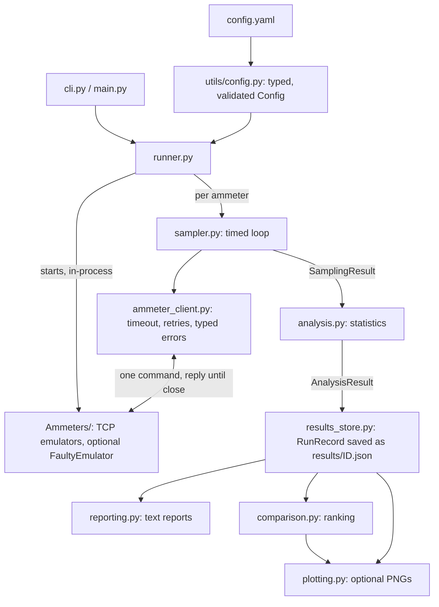

# Design decisions

How the framework is built, why, what it costs, and what was changed in the supplied code.
Usage is in [README.md](README.md).

**Contents:** [1 Approach](#1-approach) | [2 Architecture](#2-architecture) | [3 Decisions and trade-offs](#3-decisions-and-trade-offs) |
[4 Libraries](#4-libraries) | [5 Fixes to the supplied code](#5-fixes-to-the-supplied-code) | [6 Testing](#6-testing) |
[7 Limitations](#7-known-limitations) | [8 Extension ideas](#8-extension-ideas) | [9 AI usage](#9-ai-usage)

## 1. Approach

The exercise asks for a *testing framework*, not just a script, so the emphasis is on structure,
error handling and reporting: every concern (talking to an ammeter, timing, statistics, archiving,
presentation) is its own small module with a typed result, and lower layers never import higher ones.
The standard library does almost all the work; the one required third-party package is PyYAML.
Each piece was written, run and tested before the next was started (232 tests at the end), and every
result in this document that quotes a number was measured on the code as delivered.

## 2. Architecture

| Module | Responsibility | Key types |
|---|---|---|
| `utils/config.py` | load and validate YAML into immutable objects; derive the sampling plan | `Config`, `SamplingConfig`, `AmmeterConfig`, `FaultProfile`, `ConfigError` |
| `ammeter_client.py` | one request/reply exchange with an ammeter; retry policy; error taxonomy | `AmmeterClient`, `AmmeterError` and 4 subclasses |
| `sampler.py` | run a sampling plan with drift-free timing; record every attempt | `Sampler`, `Sample`, `SamplingResult` |
| `analysis.py` | descriptive statistics, outliers, consistency rating (pure functions) | `Statistics`, `AnalysisResult` |
| `results_store.py` | archive/retrieve runs; list; compare runs | `RunRecord`, `ResultsStore`, `Comparison` |
| `comparison.py` | rank the ammeters of one run | `AmmeterRanking`, `AmmeterScore` |
| `reporting.py`, `plotting.py` | text tables; optional charts. Both read a `RunRecord` | |
| `runner.py` | start emulators, sample + analyse each ammeter, build and save the record | `execute_run` |
| `cli.py` | argparse commands, exit codes, error messages | `main` |
| `Ammeters/` | the emulators; `base_ammeter.py` is the TCP server, `faulty.py` the error simulator | |

Two properties worth pointing out:

* **One code path for fresh and archived runs.** Reports, ranking and plots take a `RunRecord` (the
  JSON-shaped record), not live objects. `python main.py show <id>` therefore prints exactly what the
  original run printed, and any old run can be re-ranked or re-plotted.
* **Extension is configuration.** All three ammeters share one text protocol, so a client-side ammeter is
  a `config.yaml` entry. Only a new *emulator* needs code (one small subclass plus one registry line).

## 3. Decisions and trade-offs

### 3.1 One generic client instead of one class per ammeter
The commands, ports and hosts differ; the protocol does not. A class per ammeter would be three copies
of the same code. *Cost:* if a real device ever needed a different parser, the client would need a
strategy hook (see extensions); until then that would be speculative.

### 3.2 Errors are typed, and the type decides the retry policy

| Exception | Cause | Retried? | Why |
|---|---|---|---|
| `AmmeterConnectionError` | refused, reset, unreachable | yes | transient: the device may be restarting |
| `AmmeterTimeoutError` | no complete reply within the timeout | yes | transient |
| `AmmeterMalformedResponseError` | empty, not UTF-8, not a number, NaN/inf, over 1 KB | yes | a corrupted frame may not repeat |
| `AmmeterRejectedError` | explicit `ERROR ...` reply | **no** | the device understood and refused; resending the same command cannot help |

The timeout is one *deadline for the whole exchange*, not per `recv`: a server that dribbles one byte
at a time cannot hold the client (a test does exactly this). The reply is read until the server closes
the connection, which is how the emulators end a reply.

### 3.3 Timing
Sample *k* is due at `t0 + k x interval` on `time.perf_counter()`. Each wait targets that absolute
deadline instead of "sleep one interval after the previous sample", so the time a measurement takes
never becomes drift (a test with 20 ms of work in a 50 ms slot would be 0.4 s late by sample 20 under
the naive loop; the mutation check confirms the test catches it). The wait sleeps coarsely and
busy-waits the last 5 ms, because `time.sleep` overshoots: I measured 1.6 ms mean lateness with a 2 ms
spin window and 0.01 ms with 5 ms, on macOS. In the clean sample run the worst lateness is 0.05 ms (in the fault-simulation sample it is seconds, which is the catch-up after delayed replies, and is reported as such).

*Trade-offs.* (1) If a measurement overruns its slot, later samples run immediately to catch up and
their lateness is recorded; samples are never skipped, so the requested count is always honoured. The
alternative (skip missed slots) keeps a clean grid but returns fewer samples than asked. (2) Spinning
costs up to 5 ms of CPU per sample, fine at test rates, wasteful above a few hundred hertz. (3) The
ammeters are sampled one after another, not concurrently, so they cannot disturb each other or the
timing; a run takes the sum of their durations, and readings are not time-paired across ammeters.

### 3.4 A failed sample is data, not a crash
Only `AmmeterError` is caught per sample; the sample is recorded with its error type, message and
number of attempts, and sampling continues. Any other exception is a bug and propagates. A run in which
every sample failed still produces a result (`current = None`, rating "insufficient data"), is archived,
and exits with code 1. `attempts` is recorded for successes too, so "succeeded on the third try" is
visible as a reliability signal.

### 3.5 Statistics
* Standard deviation is the **sample** deviation (n-1), the right estimator for a handful of readings
  from a larger population; it is `None` (not a fake 0) for a single reading.
* **Coefficient of variation** (stdev / |mean|) is the precision measure, because the ammeters measure in
  ranges that differ by three orders of magnitude (about 0.03 A, 70 A and 1 A on average) and an absolute
  standard deviation would be meaningless to compare. It is `None` for a zero mean.
* **Outliers** use the z-score (|z| above `outlier_z_threshold`, default 3): simple and explainable.
  *Known weakness:* with the sample stdev the largest possible |z| is (n-1)/sqrt(n), 2.85 for n=10, so a
  single wild value in 10 readings can never be flagged. A test documents this. Robust alternative: the
  median/MAD rule (see extensions). At the default n=20 it is not a problem (maximum 4.25).
* The **consistency label** (excellent < 1%, good < 5%, fair < 20%, else poor) is a convention, not a
  standard. These emulators are random generators, so every one rates "poor"; the ranking, not the
  label, is what discriminates between them.

### 3.6 Comparing ammeters: precision, not accuracy
Accuracy needs a reference value and the same measured quantity. Neither exists here: the emulators are
independent random generators with unrelated ranges. Claiming a "most accurate ammeter" would be
fiction, so the framework does not; every ranking says so. What it does quantify:

* **Reliability**: share of requests that produced a valid reading.
* **Precision / repeatability**: the CV, with a **95% percentile-bootstrap interval** (1000 resamples,
  seeded, so a stored run always yields the same interval). Two ammeters are called different only if
  their intervals do not overlap; otherwise the report says they are not statistically distinguishable.
  This matters: with 20-50 samples the CV of ENTES and CIRCUTOR is statistically a tie, and their rank
  swaps from run to run (it did, between consecutive runs).
* **IQR/median** as an outlier-robust cross-check; if CV and IQR disagree about the most repeatable
  ammeter, a heavy-tail note is added.

*Ranking rule:* highest success rate first, ties broken by lowest CV. So in the fault-simulation sample
Greenlee ranks first although its CV is the *highest*: it never failed. That follows from the stated
rule (a flaky device is less reliable regardless of how steady its good readings are) and is shown in
the table so nobody has to guess.

### 3.7 The results store
One self-contained JSON file per run, `results/<run_id>.json`, holding the config snapshot, metadata,
every raw sample and the analysis. IDs are `UTC start time + 6 random hex digits`
(`20261028T103230Z-586431`): unique, human-readable, and chronologically sortable by file name, so
listing needs no index. Runs can be referenced by full ID, unique prefix, or `latest`; references are
validated against `[0-9A-Za-z-]+` so they cannot escape the directory. Writes are atomic (temp file +
`os.replace`) and never overwrite; a `schema_version` guards against reading a future format; corrupt files
are skipped when listing and reported when loaded.

*Alternatives:* SQLite is the natural upgrade for thousands of runs or queries across them (the cost here
is that `list` reads every file); CSV loses the structure. JSON is diff-able, needs no
dependency, and a reviewer can open a run in any editor.

### 3.8 Strict, typed configuration
`load_config` returns frozen dataclasses and raises `ConfigError` naming the offending key. Unknown
keys are rejected (a typo such as `comand` must not silently run with a default), booleans are not
accepted as numbers, and impossible combinations (rates summing above 1, a sampling plan whose count,
duration and frequency disagree) fail at load time. The config snapshot saved with each run contains
only JSON-native types so a record equals itself after a save/load round trip (a test found that
tuples broke this).

### 3.9 Emulator server
The supplied server handled one client at a time with no timeouts. It now serves each connection in its
own thread with a timeout, replies `ERROR ...` instead of silence, sets `SO_REUSEADDR`, and has
`start()`/`stop()` with a readiness event, so "is it up?" is answered by `start()` returning rather than
by `sleep(5)`. `handle_request(bytes)` is separated from the socket code, which makes the server easy to
test and is the hook the fault injector overrides. The measurement logic of the three emulators is
untouched.

### 3.10 Error simulation
`FaultyEmulator` is a decorator around any emulator: same command and measurements, but each *valid*
request may suffer one fault (dropped connection, delayed reply, garbage reply, `ERROR` reply) drawn
from a seeded private `random.Random` (reproducible, and it does not disturb the global generator).
Wrong commands are still rejected normally, so a protocol error is never confused with an injected
fault. It is configured per ammeter in YAML, recorded in the run's config snapshot, and announced in
the report (`Faults: SIMULATED ...`). Tests show each fault type is detected and classified, that
retries recover transient faults, that every injected fault is accounted for in the result, and that a
completely broken ammeter still yields a result.

### 3.11 Optional visualisation
matplotlib is imported lazily with the non-interactive Agg backend, so the framework imports and runs
without it, plots work on machines with no display, and a missing install is a warning during `run`
(an error only for the explicit `plot` command). Plots are drawn from stored records, so any archived
run can be plotted later.

### 3.12 Output discipline
Reports go to stdout; logs go to stderr (and optionally a file), so `python main.py > report.txt` is
clean. The emulators `print()` every measurement (supplied behaviour, left alone); when the runner
starts them in-process it routes that output to DEBUG logs instead of letting it flood the report.

## 4. Libraries

| Library | Required? | Used for | Why this and not something else |
|---|---|---|---|
| **PyYAML 6.0.3** | yes | reading `config.yaml` | the standard library has no YAML parser, and the exercise suggests YAML config. (JSON would need no dependency but is poor for hand-edited, commented config; `tomllib` only exists from Python 3.11) |
| **matplotlib 3.11.2** | optional | the three PNG plots | the only way to produce charts; imported lazily. Installing it also installs its own dependencies: numpy, pillow, contourpy, cycler, fonttools, kiwisolver, packaging, pyparsing, python-dateutil, six. None is imported by this project |
| **pytest 9.2.0** | dev only | the test suite | readable asserts, fixtures, parametrisation. (8.4.2 also verified on Python 3.9) |

**Libraries I installed** (into a local `.venv`, nothing globally): `pyyaml`, `matplotlib` (with the
transitive packages above) and `pytest`. A second throwaway environment on the system Python 3.9.6
(pyyaml 6.0.3, matplotlib 3.9.4, pytest 8.4.2) was used only to verify the minimum version.

**Removed from the supplied `requirements.txt`: numpy, scipy, pandas, seaborn.** The framework needs
mean, median, sample stdev and quartiles, all in the standard-library `statistics` module, and a
bootstrap, which is `random.choices`. scipy would add significance tests the exercise does not ask for;
pandas and seaborn would only add weight. Standard library modules used: `socket`, `threading`,
`statistics`, `random`, `json`, `argparse`, `logging`, `dataclasses`, `pathlib`, `time`, `uuid`, `re`,
`platform`, `contextlib`, `datetime`, `math`, `os`, `io`, `collections`, `typing`, `abc`, `sys`.

## 5. Fixes to the supplied code

Every change to the provided code, with what / why / where. Emulator *measurement logic* (the formulas,
value ranges, the console prints in the three emulator subclasses) is deliberately unchanged, as are the
exact command strings, ports (5000/5001/5002) and `generate_random_float`.

| # | What | Why | Where |
|---|------|-----|-------|
| 1 | Added `__init__.py` to `Ammeters/`, `src/`, `src/utils/`, `src/testing/` | Imports only worked as implicit namespace packages; explicit packages are reliable with pytest and tooling | those directories |
| 2 | Translated Hebrew comments/docstrings to English | Consistency; no logic changed | `src/utils/config.py`, `src/utils/logger.py`, `examples/run_tests.py` (these two were rewritten/removed later, see rows 15-17) |
| 3 | Server socket sets `SO_REUSEADDR` | Without it, restarting right after a run fails with "Address already in use" (connections in TIME_WAIT). This is why the original `main.py` suggested "increase sleep time" | `Ammeters/base_ammeter.py` `start_server` |
| 4 | Unknown/empty request now gets an explicit reply `ERROR UNKNOWN_COMMAND` | The server used to send nothing, so the client could only say "No data received" and the cause (wrong command) was invisible | `base_ammeter.py` `handle_request` |
| 5 | Each connection is served in its own thread, with a per-connection timeout (`client_timeout`, default 5 s) | The server handled one client at a time and had no timeout: one client that connected and sent nothing blocked everyone forever | `base_ammeter.py` `_serve_client` |
| 6 | I/O errors on a connection (reset, broken pipe, timeout) are caught and logged; an exception inside `measure_current()` becomes an `ERROR INTERNAL` reply | A single bad client or measurement used to be able to kill the accept loop / thread | `base_ammeter.py` `_serve_client`, `handle_request` |
| 7 | Added `start()` / `stop()` / context manager, with a readiness event; `start()` re-raises bind errors (e.g. port in use) | `main.py` started daemon threads and slept 5 s hoping the servers were up; a bind failure was only a traceback in a background thread. `start()` returns exactly when the socket is listening | `base_ammeter.py` |
| 8 | `port=0` is supported; the real port is exposed as `self.port` after start | Lets integration tests use a free port instead of a hard-coded one | `base_ammeter.py` |
| 9 | `print()` in the base server replaced by `logging` (subclasses' measurement prints are untouched) | Library code should not write to stdout; log level is controlled by the caller | `base_ammeter.py` |
| 10 | `config/config.yaml` filled in and the `ammeters` section un-commented, with ports **5000 / 5001 / 5002** | The file was mostly empty. The ports follow the README and the config (the original `main.py` used 5001-5003, which contradicted both; `main.py` itself is fixed when the runner replaces it) | `config/config.yaml` |
| 11 | CIRCUTOR command in the config is `MEASURE_CIRCUTOR -get_measurement -current` | The emulator compares the request byte-for-byte against this string. The README and the commented config omitted `-current`, and `main.py`'s commented call sent just `MEASURE_CIRCUTOR`, so every one of these would have been rejected. `tests/test_config.py::test_shipped_config_matches_emulators` guards against the config drifting from the emulators again | `config/config.yaml` |
| 12 | `load_config` now returns a validated, typed `Config` (raises `ConfigError`) and no longer depends on the current directory for its default path | The original returned a raw dict, with no validation and a CWD-relative path | `src/utils/config.py` |
| 13 | `Ammeters/client.py` `request_current_from_ammeter` is now a thin wrapper over `AmmeterClient`: it has a timeout, reads until the server closes, returns the value and raises a specific exception | Original did one `recv(1024)` with no timeout, printed "No data received." for every failure (wrong command, dead server, empty reply all looked identical) and returned nothing | `Ammeters/client.py` |
| 14 | `main.py` rewritten as a thin entry point to the CLI (`src/cli.py`). Fixes: ports 5001-5003 -> 5000-5002 (from the config), the commented-out calls sent `MEASURE_GREENLEE` / `MEASURE_ENTES` / `MEASURE_CIRCUTOR` instead of the real commands, and `time.sleep(5)` replaced by `start()`, which returns exactly when each socket is listening | The original never produced any data: wrong ports, wrong commands, and a blind sleep instead of a readiness check | `main.py`, `src/cli.py`, `src/runner.py` |
| 15 | Removed `src/testing/test_framework.py` (and the package) | It could not even be imported (`Dict` never imported), `run_test()` was an empty stub and took an argument its caller did not pass. The README also referred to a non-existent `AmmeterTester.py`. Replaced by `src/runner.py` | `src/testing/` (deleted) |
| 16 | Removed `examples/run_tests.py`, added `examples/programmatic_usage.py` | The old script called `run_test()` with no argument (the README itself said "don't use it"). The new one shows the library layers (client, sampler, analysis) used without the CLI | `examples/` |
| 17 | `logger.py` finished: `setup_logging()` attaches a stderr handler and an optional file handler | The original built a log path but never attached a handler, so nothing was ever logged. The old `TestLogger` wrapper class was dropped because nothing needs it; modules use standard `logging.getLogger(__name__)`. The stderr handler looks up `sys.stderr` at emit time so captured/redirected streams cannot leave it writing to a closed file | `src/utils/logger.py` |
| 18 | Ammeter hosts are explicit `127.0.0.1` (config and defaults) instead of `localhost`. (Strictly a fix to my own client: the original client used `AF_INET` and did not have this problem; it is listed because it concerns the supplied emulators' port 5000.) | The emulators listen on IPv4 only, but `socket.create_connection("localhost")` tries `::1` first. On macOS the AirPlay Receiver (Control Center) holds port 5000 on IPv6, so the client connected to *it* and timed out. Found by running the CLI for real; covered by `test_shipped_hosts_are_explicit_ipv4`. Note: on macOS port 5000 is also taken on IPv4 by that process, but binding the specific address 127.0.0.1 still wins, so the emulator works on 5000 | `config/config.yaml`, `src/utils/config.py`, `Ammeters/base_ammeter.py`, `Ammeters/client.py` |
| 19 | README rewritten | Stale paths (`Ammeters/main.py`, but `main.py` is at the repository root), a reference to a non-existent `AmmeterTester.py` and to `examples/run_test.py`, the CIRCUTOR command without `-current`, and no usage instructions | `README.md` |
| 20 | `requirements.txt` reduced to `pyyaml`; `requirements-optional.txt` (matplotlib) and `requirements-dev.txt` (pytest) added | numpy, scipy, pandas and seaborn were listed but nothing needs them (see "Libraries") | `requirements*.txt` |

Error-reply convention: any reply starting with `ERROR` is an error; a measurement is a bare float.
The client relies on this.

**Noticed but left alone:** `AmmeterEmulatorBase.__init__` calls `random.seed(time.time())`, which
reseeds Python's *global* generator every time an emulator is created. It is harmless here (the
emulators want randomness, and the fault injector uses its own private generator) but it would defeat
reproducibility for any other code using the global `random`. It is emulator behaviour, so it was not
touched.

**Found by running the system, not by the first unit tests** (each now has a regression test):
the IPv6 `localhost` problem (row 18); a "Started" time that was really the run's end time; an
emulator thread still sleeping in a simulated delay that printed into the report after the run ended;
a configuration snapshot whose tuples made a saved run unequal to its reloaded self; and a
heavy-tail note that named the wrong ammeter.

## 6. Testing

232 tests, about 20 s, run with `pytest`. Verified passing on Python 3.9.6 and 3.14.7 (macOS).

| Layer | Approach |
|---|---|
| Config, analysis, comparison, reporting, store | pure unit tests; statistics checked against hand-computed values (for example the sample stdev of 1..5 is sqrt(2.5)); every validation rule has a failing-input test |
| Client | against a **scripted server** on a real local socket that replies in chunks, closes silently, hangs, dribbles bytes forever or sends garbage; plus the real emulators |
| Sampler | real-time tests with generous tolerances (drift, overrun, frequency accuracy), run repeatedly to check they are not flaky |
| Emulators | start/stop, restart on the same port, port in use, stalled client does not block others, each fault type |
| Integration | the real emulators on free ports, in-process and as a separate `python -m Ammeters` process, driven through the CLI end to end, including failure exit codes and error messages |

*Real sockets instead of mocks.* The exercise suggests mocking sockets; where the behaviour under test
*is* the socket behaviour (timeouts, partial reads, resets, restart on the same port) a mock would only
test my assumptions about sockets, so those tests use real loopback sockets on OS-assigned free ports.
Logic that does not touch the network is tested directly.

*Do the tests test anything?* Spot mutation checks: removing `SO_REUSEADDR`, serving clients inline,
a per-`recv` instead of whole-exchange timeout, a naive sleep-after-each-sample loop, ranking precision
before reliability, and an uninterruptible fault delay each make the matching test fail.

## 7. Known limitations

1. **Accuracy cannot be assessed** (3.6): only reliability and repeatability.
2. **z-score outliers miss a lone outlier when n is small** (3.5).
3. **Consistency labels are conventional**; all emulators rate "poor". Use the ranking.
4. **Ammeters are sampled sequentially**, so a run takes the sum of their durations and readings are not time-paired.
5. **Sampling rate ceiling.** Every measurement opens a new TCP connection (about 0.6-0.8 ms here), and the
   precise wait spins up to 5 ms per sample; practical rates are well under 1 kHz.
6. **No early abort.** A dead ammeter that accepts connections and never replies costs up to
   `count x (retries + 1) x timeout` before the run reports it (this is what happened on macOS before
   fix 18, when another process on port 5000 accepted connections and never replied: 18 s for 3 samples).
   A "stop after N consecutive failures" option would fix it.
7. **Close-delimited protocol.** A device that sent a valid number but kept the connection open would time out.
8. **Fault simulation is for in-process emulators only**; with `--external` the `faults` setting is ignored.
9. **Platforms.** Verified on macOS only (Python 3.9.6, 3.14.7). The code uses portable standard-library
   features, but sleep granularity on Windows is coarser (about 15 ms) and would show up as schedule lateness.
10. **Store scalability.** `list` reads every run file; there is no locking beyond unique IDs and atomic writes.
11. **Statistical power.** With 20-50 samples the CV intervals are wide (for example 39.0%-57.7% around a CV of 48.4% for 50 samples);
    more samples narrow them, and the report shows the interval so this is visible.

## 8. Extension ideas

* **Acceptance criteria as config** (`max_cv`, `min_success_rate`, `max_latency`) turning a run into a
  pass/fail gate for CI; the exit code already carries "failures happened".
* Concurrent sampling of all ammeters on a shared timeline, to compare them paired in time.
* Early abort after N consecutive failures; adaptive timeouts from observed latency.
* Robust outliers (median/MAD) and a significance test between runs (Mann-Whitney) in `compare`.
* A response-parser strategy per ammeter for devices with a different wire format, and a serial/Modbus transport.
* CSV export, SQLite backend for the store, trend plots across runs (`compare` already returns the data).
* A GitHub Actions workflow running `pytest` on Linux, macOS and Windows (would also close limitation 9).

## 9. AI usage

This solution was developed with the assistance of an AI coding assistant (Claude Code); I reviewed and ran all of it, and I can explain and defend every part.
