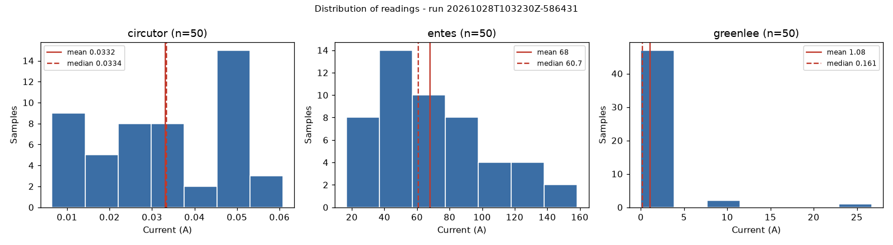
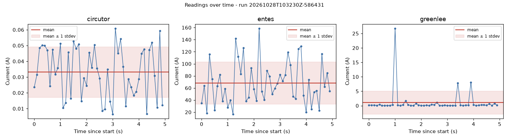
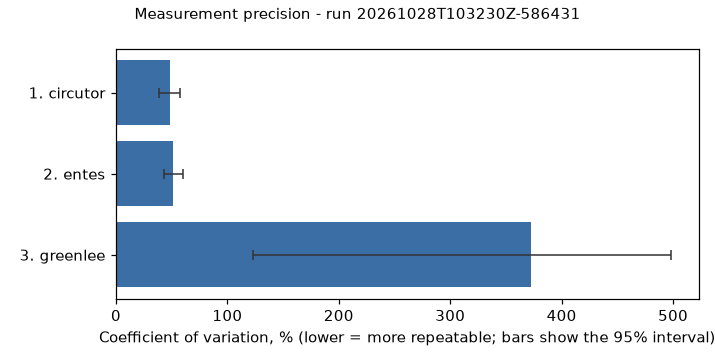

# Ammeter Test Framework

A testing framework for three ammeter emulators (**Greenlee**, **ENTES**, **CIRCUTOR**), each a TCP
socket server on localhost. It reads measurements through one unified client, samples them with
precise timing, analyses them statistically, archives every run, and compares the ammeters.

```
config.yaml -> client -> sampler -> analysis -> results store (JSON) -> report / ranking / plots
                 ^                                   
        emulators (started in-process, or running elsewhere with --external)
```

Design decisions, trade-offs, libraries and every fix to the supplied code are in **[DESIGN.md](DESIGN.md)**.

## Quick start

Requires Python 3.9 or newer (tested on 3.9.6 and 3.14.7, macOS).

```sh
python3 -m venv .venv
source .venv/bin/activate            # Windows: .venv\Scripts\activate
pip install -r requirements-dev.txt  # pyyaml + matplotlib (plots) + pytest
python main.py
```

`python main.py` starts the three emulators, takes 20 measurements from each, prints a report and a
ranking, archives the run under `results/` and writes plots. Only `pyyaml` is required; without
matplotlib the plots are skipped with a warning (`pip install -r requirements.txt` for the minimum).

## Usage

```sh
python main.py                                  # same as `python main.py run`
python main.py run -n 50                        # 50 samples per ammeter at the configured rate
python main.py run -a entes greenlee -d 5 -f 20 # two ammeters, 5 s at 20 Hz (= 100 samples)
python main.py run -l "after firmware update"   # free-text label stored with the run
python main.py list                             # archived runs, newest first
python main.py show latest                      # report of an archived run (id, unique prefix, or latest)
python main.py compare <run> <run> [<run> ...]  # same metrics side by side, with % change
python main.py plot latest -t histogram         # (re)generate plots for an archived run
python main.py --help                           # every option
```

| `run` option | Meaning |
|---|---|
| `-a/--ammeter NAME...` | which ammeters to test (default: all in the config) |
| `-n/--count`, `-d/--duration`, `-f/--frequency` | sampling plan overrides. Two or more replace the configured plan; a single one keeps the rest (`-n`/`-d` keep the frequency, `-f` keeps the count). Contradictory values are rejected |
| `--external` | do not start emulators; use ammeters that are already running |
| `--no-save`, `--no-plots` | skip archiving (and plots) / skip only plots |
| `--config PATH`, `--results-dir DIR`, `--log-level LEVEL`, `-l/--label TEXT` | as named |

**Exit codes:** `0` all samples succeeded, `1` the run completed but some samples failed, `2` usage,
config or storage error. Errors print a one-line `error: ...` message, never a traceback.

**Emulators in a separate process** (the realistic setup, e.g. for real devices):

```sh
python -m Ammeters                 # terminal 1: starts the emulators from config.yaml
python main.py run --external      # terminal 2
```

**As a library** (client -> sampler -> analysis, no CLI): see
[examples/programmatic_usage.py](examples/programmatic_usage.py).

## Sampling

The plan is configurable by **number of measurements**, **total duration** and **sampling frequency**.
Give any two; the third is derived (`count = duration x frequency`). If you give all three they must
agree. Sample *k* is due at `t0 + k x interval` on a monotonic clock, so measurement time never
accumulates as drift; each sample records when it was due, when it really started, and its latency
(see "Timing" in DESIGN.md). On this machine the schedule lateness is about 0.05 ms at 10 Hz.

## Results and analysis

For each ammeter: **mean, median, standard deviation (sample, n-1), minimum, maximum**, plus the
coefficient of variation (CV), outlier count, success rate, retries, latency and schedule lateness.
Every run is archived as one JSON file with a unique ID (`20261028T103230Z-586431`: UTC start time +
random suffix), the full config snapshot, metadata, every raw sample and the analysis.

When two or more ammeters are run, they are **ranked by reliability (success rate), then precision
(CV with a bootstrap 95% interval)**; statistical ties and heavy-tailed data are flagged. This measures
*repeatability, not accuracy*: there is no reference current and the emulators produce unrelated
quantities, so true accuracy cannot be assessed (see DESIGN.md).

### Sample results

Committed in [`results/samples/`](results/samples/): a clean run and a run with simulated faults, each
as JSON, a text report and plots. The clean run (50 samples, 10 Hz):

```
Ammeter      OK  Mean (A)  Median (A)  Stdev (A)  Min (A)  Max (A)      CV  Outliers  Consistency  Latency (ms)  Max late (ms)
--------  -----  --------  ----------  ---------  -------  -------  ------  --------  -----------  ------------  -------------
circutor  50/50   0.03317     0.03336    0.01606  0.00648   0.0608   48.4%         0         poor          0.59           0.05
entes     50/50     68.02       60.74      35.05     16.7    158.5   51.5%         0         poor          0.66           0.05
greenlee  50/50     1.079      0.1608      4.016  0.01283    26.73  372.2%         1         poor          0.81           0.05
```

Full reports: [clean run](results/samples/20261028T103230Z-586431-report.txt),
[run with simulated faults](results/samples/20261028T103246Z-e7ac61-report.txt).

| Distribution | Over time | Precision |
|---|---|---|
|  |  |  |

## Error simulation

Any in-process emulator can be made to misbehave, per ammeter, from the config (seeded, so reproducible):

```yaml
ammeters:
  entes:
    ...
    faults: {drop_rate: 0.2, garbage_rate: 0.1, seed: 7}   # also delay_rate/delay_seconds, error_rate
```

Each request suffers at most one fault: dropped connection, delayed reply, garbage reply, or an `ERROR`
reply. `python main.py run --config config/faulty_example.yaml` is a ready-made example. Failed samples
are recorded with their error type, retries recover transient faults, the report says
`Faults: SIMULATED ...`, and the run exits with code 1.

## Configuration

`config/config.yaml` (unknown keys and invalid values are rejected with the key's path):

| Key | Meaning |
|---|---|
| `testing.sampling.measurements_count`, `total_duration_seconds`, `sampling_frequency_hz` | sampling plan (any two) |
| `ammeters.<name>.host / port / command` | how to reach each ammeter (one entry per ammeter; add a 4th here) |
| `ammeters.<name>.faults` | optional error simulation (above) |
| `client.timeout_seconds / retries / retry_delay_seconds` | per-attempt timeout; extra attempts after a retryable failure |
| `analysis.outlier_z_threshold` | \|z-score\| above which a reading counts as an outlier (default 3) |
| `analysis.visualization.enabled / plot_types` | plots: `histogram`, `time_series`, `precision` |
| `result_management.directory` | where runs, plots and logs go (default `results/`) |
| `logging.level / to_file` | console (stderr) level; also write `results/logs/run-<UTC start time>.log` |

## The ammeter emulators

| Ammeter | Port | Command (sent exactly) | Measurement |
|---|---|---|---|
| Greenlee | 5000 | `MEASURE_GREENLEE -get_measurement` | Ohm's law, I = V / R, V 1-10 V, R 0.1-100 ohm |
| ENTES | 5001 | `MEASURE_ENTES -get_data` | Hall effect, I = B x K, B 0.01-0.1 T, K 500-2000 |
| CIRCUTOR | 5002 | `MEASURE_CIRCUTOR -get_measurement -current` | Rogowski coil, I = integral of V dt, 10 samples of 0.1-1.0 V, step 0.001-0.01 s |

A reply is either a bare number (amperes) or a line starting with `ERROR` (for example
`ERROR UNKNOWN_COMMAND`). Adding an emulator: one small subclass of `AmmeterEmulatorBase`, one line in
`Ammeters/__init__.py`, one entry in `config.yaml`. Adding a *client-side* ammeter (real device) needs
only the config entry.

## Project structure

```
main.py                    entry point (-> src/cli.py)
config/                    config.yaml, faulty_example.yaml
Ammeters/                  the provided emulators (fixed, see DESIGN.md)
  base_ammeter.py            TCP server base class: threads, timeouts, start()/stop(), error replies
  Greenlee_/Entes_/Circutor_Ammeter.py   the three emulators (measurement logic unchanged)
  faulty.py                  FaultyEmulator: error simulation
  __init__.py                EMULATORS registry          __main__.py   python -m Ammeters
  client.py                  legacy helper, now a thin wrapper over src/ammeter_client.py
src/
  ammeter_client.py          unified client: timeout, retries, typed exceptions
  sampler.py                 drift-corrected sampling, per-sample timing and errors
  analysis.py                statistics, CV, outliers, consistency rating
  comparison.py              ranking of ammeters (reliability, precision, bootstrap interval)
  results_store.py           JSON archive: save / load / list / compare
  runner.py                  orchestration: start emulators, sample, analyse, archive
  reporting.py, plotting.py  text reports; optional matplotlib plots
  cli.py                     argparse commands
  utils/                     config.py (typed, validated), logger.py, Utils.py
examples/programmatic_usage.py
tests/                     232 tests
results/samples/           committed sample runs (everything else under results/ is git-ignored)
Exam/                      the exercise specification
```

## Tests

```sh
pytest            # 232 tests, about 20 s
```

Unit tests cover config validation, the client against a scripted misbehaving server, sampler timing,
statistics against hand-computed values, the store, ranking and reporting. Integration tests start the
real emulators on free ports (in-process and as a separate process) and drive the CLI end to end.
Plot tests are skipped if matplotlib is not installed.

## Troubleshooting

- **macOS, port 5000:** the AirPlay Receiver (Control Center) listens on port 5000. The default config uses
  explicit `127.0.0.1` addresses, which still reach the emulator, so this works as is. If you ever see
  Greenlee time out while 5001/5002 work, either turn off *System Settings -> General -> AirDrop &
  Handoff -> AirPlay Receiver* or change the Greenlee port in `config.yaml`.
- **"cannot start the ... emulator ... use --external":** the port is taken (often by a previous run's
  emulators started with `python -m Ammeters`). Stop that process, or use `--external`.
- **"plots skipped ... matplotlib is not installed":** `pip install -r requirements-optional.txt`.
- **Windows / Linux:** the code uses only portable standard-library features, but it has been run on macOS only.
  Sleep granularity differs by platform; the report's "Max late" column shows the resulting schedule error.

## AI usage

This solution was developed with the assistance of an AI coding assistant (Claude Code); I reviewed and ran all of it, and I can explain and defend every part.
